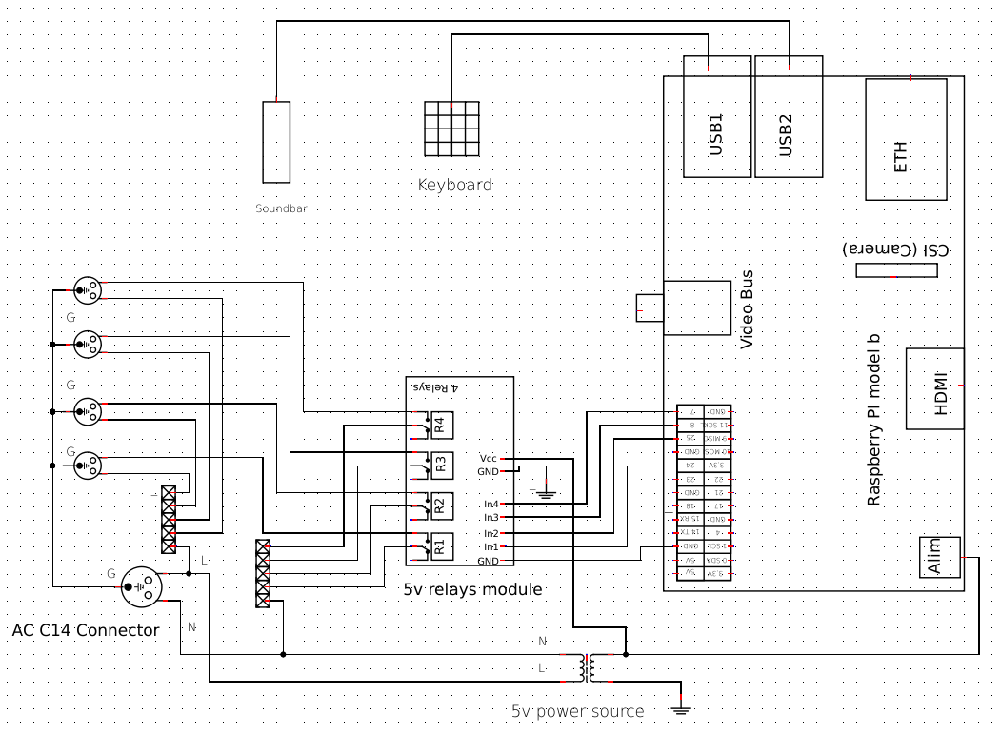

# Media center controller with a numpad keyboard and Home Assistant integration

## Project goals

To control some connected electronics (soundbar, turntable, preamp, printer, etc) from a physical mini keyboard.
1. Turn on/off printer
2. Turn on/off soundbar + turntable
3. Turn on/off soundbar + select mode for movie watching or music streaming
4. Expose to HomeAssistant as MQTT device(s) to eventually control it via intents.
5. AirPlay 2 receiver: power on the soundbar when a client connects, restore it when the client leaves.

## Hardware

1. Raspberry Pi 2B
2. Relays controller with 4 relays
3. YSP-4000 soundbar (see [ysp4000 repository](https://github.com/pzbitskiy/yamaha-ysp-4000))
4. Dumb but solid Dell 1700 printer (CUPS + Lexmark E234 PPD)
5. Turntable and preamp
6. Pi HDMI output to the YSP-4000 DVD (HDMI) input for AirPlay audio

### Keyboard setup

Inspired by this [blog post](https://softsolder.com/2016/03/02/raspberry-pi-usb-keypad-via-evdev/)

```sh
cat /proc/bus/input/devices
```

Take vendor id and product id and created udev rule

```sh
sudo bash -c 'cat > /etc/udev/rules.d/KeyPad.rules << EOF
ATTRS{idVendor}=="04b4", ATTRS{idProduct}=="06b0", SYMLINK+="input/keypad"
EOF'

sudo udevadm control --reload
```

Now the keyboard can be opened as `/dev/input/keypad` device:

```python
keypad = InputDevice('/dev/input/keypad')
```

### Relays, outlets and RPi

See the wiring diagram


## Installation instructions

### Build

```sh
python3 -m build
```

### Install

On the device

```sh
pip3 install --upgrade --user git+https://github.com/pzbitskiy/media_center_kb

# Run in foreground with verbose logging to ensure it works as intended
mediackb -v
```

Create systemd service

```sh
sudo bash -c 'cat > /etc/systemd/system/media-center-kb.service <<EOF
[Unit]
Description=Media center keyboard daemon
Wants=shairport-sync.service

[Install]
WantedBy=multi-user.target

[Service]
User=pi
RuntimeDirectory=media-kb
RuntimeDirectoryMode=0750
ExecStart=mediackb --mqtt /etc/mcb/mqtt.json --control-socket /run/media-kb/control.sock --airplay-metadata /tmp/shairport-sync-metadata
Type=idle
RemainAfterExit=no
Restart=on-failure
EOF'

sudo systemctl daemon-reload
sudo systemctl start media-center-kb
sudo systemctl enable media-center-kb
```

Ensure it is running

```sh
sudo systemctl --type=service --state=running
```

#### Python 3.10 and Raspberry Pi 2B / Raspbian GNU/Linux 11

After installing `python3.10` RPi.GPIO cannot be imported.
Simple fix is to give 3.10 extension assuming there were no extension API change 3.9->3.10:
```sh
sudo cp /usr/lib/python3/dist-packages/RPi/_GPIO.cpython-39-arm-linux-gnueabihf.so \
    /usr/lib/python3/dist-packages/RPi/_GPIO.cpython-310-arm-linux-gnueabihf.so
```

### AirPlay 2 receiver

[shairport-sync](https://github.com/mikebrady/shairport-sync) plays AirPlay 2 audio through the Pi HDMI output
into the soundbar DVD input. Its session hooks call `mediackb-airplay`, which talks to `mediackb` over
`/run/media-kb/control.sock`:
- client connects: power on the soundbar if needed, select DVD input, music mode and 5ch stereo.
  Apple TV gets cinema mode instead: the client model comes from the shairport-sync metadata pipe
  (`--airplay-metadata`), models starting with `AIRPLAY_MOVIE_MODEL_PREFIXES` get 5 beam and cinema mode.
- client disconnects (after `active_state_timeout` of silence): turn the previous source (TV, BT or turntable)
  back on with its volume, or power the soundbar off if it was off.
  If the soundbar was switched off or to another source during the session, it is left alone.
  Inputs selected with the soundbar's own remote are not tracked.
- AirPlay volume (e.g. the Apple TV remote) sets the soundbar volume while AirPlay owns the soundbar,
  capped at `AIRPLAY_MAX_VOLUME_PCT`
- Home Assistant gets an `AirPlay` device with a read-only `Active` sensor

#### HDMI audio

The soundbar may not report a display or audio support over HDMI (nothing is connected to its HDMI output),
so the Pi has to force HDMI with audio on. Instructions are for Raspbian 11 (bullseye).

Check which video driver is in use:
```sh
grep -E '^dtoverlay=vc4-(f)?kms' /boot/config.txt
```

**Legacy firmware driver (recommended for this audio-only Pi).** If the line above is `dtoverlay=vc4-kms-v3d`,
comment it out. Then make sure `/boot/config.txt` has:
```
dtparam=audio=on
hdmi_force_hotplug=1
hdmi_drive=2
```
`hdmi_drive=2` forces HDMI mode with audio even when the soundbar does not report audio support.
The HDMI device is `hw:CARD=b1,DEV=0` (`bcm2835 HDMI 1` in `aplay -l`).

**KMS driver (`dtoverlay=vc4-kms-v3d`).** The `hdmi_*` options above are ignored.
Append to the single line in `/boot/cmdline.txt`:
```
vc4.force_hotplug=1 video=HDMI-A-1:1280x720@60D
```
The HDMI device is `hdmi:CARD=vc4hdmi,DEV=0`. KMS enables HDMI audio only if the sink's EDID reports audio,
so if `speaker-test` stays silent, switch to the legacy driver.

Reboot, then check the sound reaches the soundbar (select DVD input on the soundbar first):
```sh
aplay -l
speaker-test -D hw:CARD=b1,DEV=0 -c2 -t wav    # legacy
speaker-test -D hdmi:CARD=vc4hdmi,DEV=0 -c2 -t wav    # KMS
```

#### Build nqptp and shairport-sync

Distro packages are usually built without AirPlay 2, so build both from source.
shairport-sync is pinned to 5.5.2: 5.6 stopped reporting the client model in the metadata,
so every client would get the music profile. nqptp is pinned to 1.2.8, the last release with
the shared memory interface version (smi10) shairport-sync 5.5.2 requires.
Build them either natively on the Pi (slow on a Pi 2) or cross-built on an x86_64 machine.
Check [BUILD.md](https://github.com/mikebrady/shairport-sync/blob/master/BUILD.md) for the exact package list for your OS.

##### Native build on the Pi

```sh
sudo apt install --no-install-recommends build-essential git autoconf automake libtool \
    libpopt-dev libconfig-dev libasound2-dev avahi-daemon libavahi-client-dev libssl-dev libsoxr-dev \
    libplist-dev libplist-utils libsodium-dev libavutil-dev libavcodec-dev libavformat-dev uuid-dev libgcrypt-dev xxd

git clone --branch 1.2.8 https://github.com/mikebrady/nqptp.git && cd nqptp
autoreconf -fi && ./configure --with-systemd-startup && make && sudo make install
cd ..

git clone --branch 5.5.2 https://github.com/mikebrady/shairport-sync.git && cd shairport-sync
autoreconf -fi
./configure --sysconfdir=/etc --with-alsa --with-soxr --with-avahi --with-ssl=openssl --with-systemd-startup --with-airplay-2 --with-metadata
make && sudo make install

# must list AirPlay2
shairport-sync -V
```

##### Cross-build on an x86_64 machine

Build in an emulated ARMv7 Debian bullseye container (same library versions as Raspbian 11),
install into a staging directory and copy only the installed files to the Pi.
Running `make install` on the Pi instead does not work: the build tree depends on the `-dev` headers,
so make tries to recompile.

The container uses archive.debian.org: bullseye packages are no longer on deb.debian.org (404).

```sh
# once: register qemu for ARM binaries (docker buildx ls should then list linux/arm/v7)
sudo apt install qemu-user-static binfmt-support

mkdir -p ~/rpi-build && cd ~/rpi-build
docker run --rm --platform linux/arm/v7 -v "$PWD:/work" -w /work debian:bullseye bash -euxc '
printf "%s\n" "deb http://archive.debian.org/debian bullseye main" \
              "deb http://archive.debian.org/debian-security bullseye-security main" > /etc/apt/sources.list
apt-get update
apt-get install -y --no-install-recommends build-essential git autoconf automake libtool pkg-config ca-certificates systemd \
  libpopt-dev libconfig-dev libasound2-dev libavahi-client-dev libssl-dev libsoxr-dev \
  libplist-dev libplist-utils libsodium-dev libavutil-dev libavcodec-dev libavformat-dev uuid-dev libgcrypt-dev xxd
git clone --branch 1.2.8 https://github.com/mikebrady/nqptp.git
(cd nqptp && autoreconf -fi && ./configure --with-systemd-startup && make -j$(nproc))
git clone --branch 5.5.2 https://github.com/mikebrady/shairport-sync.git
(cd shairport-sync && autoreconf -fi && \
  ./configure --sysconfdir=/etc --with-alsa --with-soxr --with-avahi --with-ssl=openssl --with-systemd-startup --with-airplay-2 --with-metadata && \
  make -j$(nproc))
rm -rf stage
(cd nqptp && make install DESTDIR=/work/stage)
(cd shairport-sync && make install DESTDIR=/work/stage)
# files only (no directory entries that could replace /lib symlinks), keep the existing shairport-sync.conf
(cd stage && find . -type f ! -path ./etc/shairport-sync.conf | tar czf ../rpi-airplay.tgz --owner=0 --group=0 -T -)
chown -R '"$(id -u):$(id -g)"' /work
'
scp rpi-airplay.tgz pi@<pi-host>:
```

On the Pi, install the runtime libraries, unpack and create the user that shairport-sync's `make install` would create
(nqptp runs as a systemd dynamic user):
```sh
sudo apt install --no-install-recommends avahi-daemon libpopt0 libconfig9 libasound2 libavahi-client3 \
    libssl1.1 libsoxr0 libplist3 libsodium23 libavutil56 libavcodec58 libswresample3 libgcrypt20
sudo tar xzf rpi-airplay.tgz -C / --keep-directory-symlink

getent group shairport-sync >/dev/null || sudo groupadd -r shairport-sync
getent passwd shairport-sync >/dev/null || sudo useradd -r -M -g shairport-sync -s /usr/sbin/nologin -G audio shairport-sync
sudo systemctl daemon-reload

# must print nothing
ldd /usr/local/bin/shairport-sync /usr/local/bin/nqptp | grep 'not found'
# must list AirPlay2
shairport-sync -V
```

#### Configure

```sh
sudo install -m 755 contrib/shairport-sync/mediackb-airplay /usr/local/bin/
sudo install -m 644 contrib/shairport-sync/shairport-sync.conf /etc/shairport-sync.conf
# set alsa.output_device to the HDMI device found above
sudo editor /etc/shairport-sync.conf

# let the hook reach the media-kb control socket
sudo usermod -aG pi shairport-sync

sudo systemctl enable --now nqptp shairport-sync
# pick up the control socket options from the service above
sudo systemctl daemon-reload
sudo systemctl restart media-center-kb
```

Check the hook manually:
```sh
sudo -u shairport-sync mediackb-airplay on
sudo -u shairport-sync mediackb-airplay volume -15
sudo -u shairport-sync mediackb-airplay off
```

## Development

### Setup
```sh
python3 -m venv .venv
source .venv/bin/activate
pip install -e '.[tests]'
# or pip3 install -e -r requirements.txt
```

### Test

```sh
pytest
```

#### HA+MQTT manual testing

```sh
docker run -d \
  --name homeassistant \
  --network=host \
  ghcr.io/home-assistant/home-assistant:stable

docker run -p 1883:1883 -v ./mosquitto.conf:/mosquitto/config/mosquitto.conf eclipse-mosquitto

python src/media_center_kb/main.py --no-kb --no-serial --no-gpio --mqtt mqtt.json --control-socket ./ctl.sock --airplay-metadata ./metadata

# AirPlay hooks
MEDIACKB_SOCKET=./ctl.sock contrib/shairport-sync/mediackb-airplay on
# AirPlay client model
printf '<item><type>73736e63</type><code>636d6f64</code><length>11</length>\n<data encoding="base64">\n%s</data></item>\n' \
    "$(printf AppleTV11,1 | base64)" > ./metadata
```